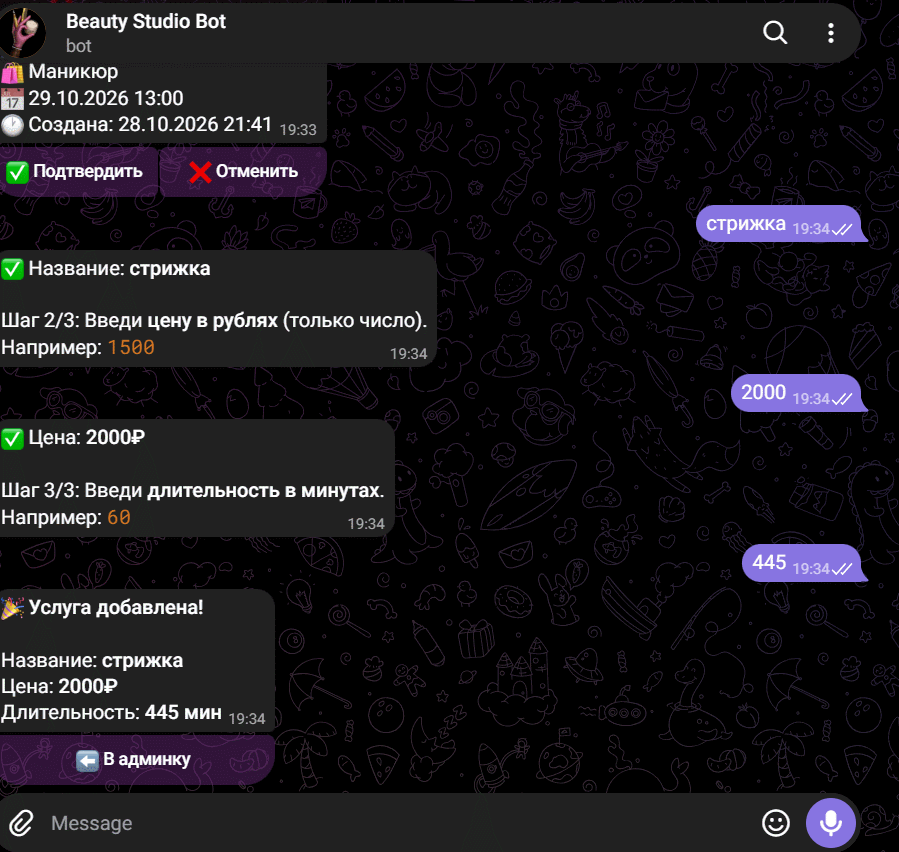

# 🤖 Telegram-бот для записи на услуги

Бот для салонов красоты, репетиторов, мастеров. Клиенты записываются сами, вы управляете из Telegram.

## 🎬 Демо
👉 **гифка-бота:**

👉 **бот:** (https://t.me/Example_info_beauty_bot))

## ✨ Функционал

**Для клиентов:**
- 📅 Запись на услугу с выбором даты и времени
- 💰 Цены и длительность услуг
- 📋 «Мои записи» — история
- ✅ Проверка занятости слотов

**Для админа (владельца):**
- 👤 Админ-панель (`/admin`)
- 📋 Управление записями (подтвердить / отменить)
- ➕ Добавление услуг
- 🗑 Удаление услуг
- 📊 Статистика
- 🔔 Уведомления о новых записях

## 🛠 Стек

- **Python 3.12**
- **aiogram 3.13** — Telegram Bot API
- **SQLAlchemy 2.0** (async) — ORM
- **SQLite** — база данных
- **FSM** — диалоги
- **Middleware** — автосоздание пользователей

